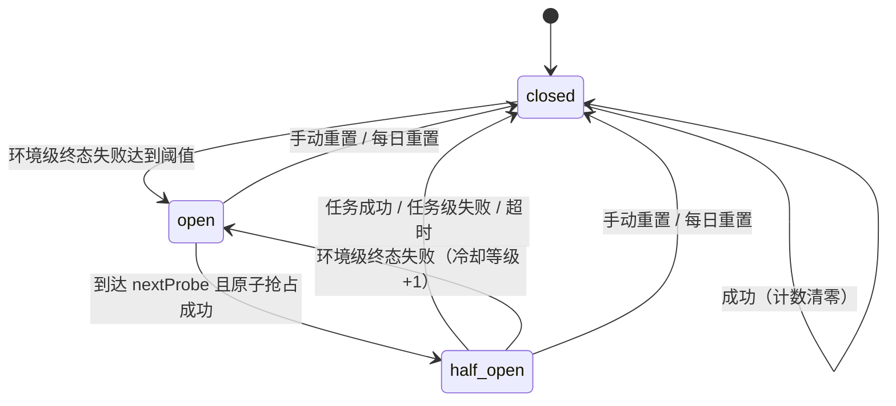
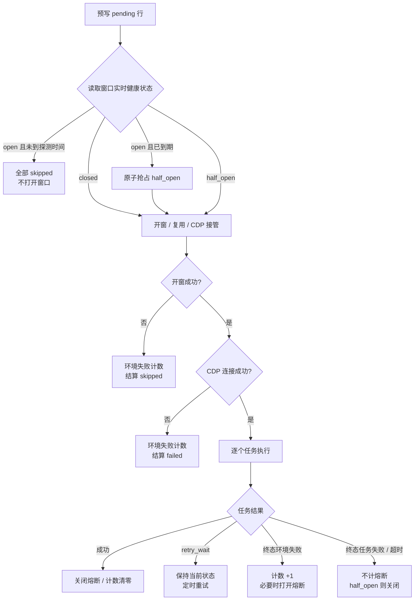

# 窗口级熔断健康状态机设计

> 日期：2026-10-19
> 状态：设计已确认，待用户 review
> 范围：任务执行引擎中的窗口级熔断、失败分类、冷却/半开探测、配置、面板展示与迁移
> 不在本次范围：任务级熔断、重试策略改造、队列并发改造、分布式多主进程

## 1. 背景

### 1.1 当前实现

当前熔断逻辑集中在 `src/engine/window-runner.ts`：

- 任务最终失败（`failed`）时，`profiles.circuit_breaker_count` 加 1。
- 任务成功时，计数清零。
- 每个任务执行前检查 `count >= execution.circuitBreakerThreshold`，达到就落 `skipped`（“窗口熔断”）。
- `execution.circuitBreakerResetEveryHours` 或 `circuitBreakerResetAt` 由 `src/engine/maintenance.ts` 定时全量清零。
- 当前配置：阈值 2、每小时重置一次。
- 重试由 `retry.max` 控制，当前为 2 次额外重试，即最多 3 次尝试、退避 600 秒。

### 1.2 当前问题

1. **所有终态失败都计数**：站点改版、选择器失效、数据源错误、AI 解析失败等任务问题也会把窗口推向熔断。
2. **窗口级误伤**：一个难任务连续失败两次，可能让同窗口其他本来能成功的任务全部跳过。
3. **开窗后才发现要跳过**：熔断检查发生在窗口已经打开、CDP 已经连接之后，坏窗口仍会消耗开窗成本。
4. **成功一次就清零**：一个简单任务成功会掩盖窗口仍然不健康的事实。
5. **固定每小时全量清零**：冷却结束直接全量恢复，没有半开探测，坏窗口可能再次连续失败。
6. **计数来自入队时的 `ProfileRow` 快照**：队列里持有的窗口记录可能已经过期，熔断判断不是实时状态。
7. **“当日熔断”语义不清晰**：当前配置每小时重置，并不是真正的当日熔断。

### 1.3 已确认的决策

用户已确认：

1. 采用方案 B：窗口健康状态机。
2. 只对窗口/环境级失败计数，任务级失败不计。
3. 阈值保持 2（连续环境级终态失败）。
4. 冷却策略：30 分钟起步，指数退避到 2 小时上限。
5. 半开探测使用真实任务，不另做专用健康检查。
6. 数据落点：扩展 `profiles` 表，暂不新建 `window_health` 表。
7. 保留每日 23:59 重置。
8. `task:run` 受熔断影响，另加 `FORCE_BREAKER=1` 调试开关。
9. UI 完整展示熔断状态、原因、下次探测时间。
10. 废弃 `circuitBreakerResetEveryHours`，忽略旧配置并告警。

## 2. 目标与非目标

### 2.1 目标

- 把熔断从“所有失败计数”改成“窗口环境健康度”判断。
- 任务业务失败不再导致窗口熔断。
- 熔断打开后，在开窗前拦截，不再浪费窗口。
- 用指数退避冷却和半开探测替代固定每小时全量清零。
- 面板能看出窗口是正常、熔断中还是探测中，以及下一次探测时间。
- 保留重试、并发、停止、重启恢复等现有语义。
- 向后兼容老数据库和老配置。

### 2.2 非目标

- 不引入任务级熔断。
- 不改变 `retry.max`、`retry_wait`、错峰、并发闸门。
- 不新增独立的健康检查任务。
- 不做多主进程分布式协调；仍以单主后端为前提，`task:run` 是例外进程。
- 不重构运行状态机本身。

## 3. 方案选择

| 方案 | 说明 | 结论 |
|---|---|---|
| A. 最小增强 | 保留现有计数，只加失败分类和冷却 | 改动小，但没有半开探测，坏窗口恢复后可能再次连续失败 |
| **B. 窗口健康状态机** | `closed / open / half_open` 三态，只计环境失败，指数退避，半开用真实任务探测 | **采用** |
| C. 删除熔断 | 完全依赖 `retry.max` 和在途守卫 | 不采用；坏窗口会持续消耗开窗、重试和额度 |

不采用任务级熔断：每个任务已经有 `retry.max` 和 `attempts`，再加任务级熔断与重试重复，且无法解决“窗口环境坏了，所有任务都会失败”的问题。

## 4. 状态机



### 4.1 状态定义

- `closed`：正常状态。任务可执行；环境级失败累加计数，达到阈值进入 `open`。
- `open`：熔断状态。未到 `next_probe_ms` 时，窗口会话直接跳过，不打开窗口。
- `half_open`：探测状态。允许一轮真实任务会话；根据探测结果关闭或重新打开。

### 4.2 转移规则

| 当前状态 | 事件 | 下一状态 | 附加动作 |
|---|---|---|---|
| `closed` | 环境级终态失败，计数 < 阈值 | `closed` | 计数 +1 |
| `closed` | 环境级终态失败，计数 +1 ≥ 阈值 | `open` | `level=0`，`next_probe_ms=now+30m`，记录原因 |
| `closed` | 任务成功 | `closed` | 计数 0，原因清空 |
| `closed` | 任务级失败 / 超时 | `closed` | 计数不变 |
| `open` | 未到 `next_probe_ms` | `open` | 跳过，不打开窗口 |
| `open` | 到达 `next_probe_ms`，原子抢占成功 | `half_open` | 记录 `probe_started_ms=now` |
| `open` | 到达 `next_probe_ms`，抢占失败 | `open` | 说明其他进程/会话正在探测，按 `open` 处理 |
| `half_open` | 任务成功 | `closed` | 计数 0，等级 0，清空原因 |
| `half_open` | 任务级终态失败 / 超时 | `closed` | 说明窗口可用，计数 0，等级 0 |
| `half_open` | 任务级失败 / 超时但仍可重试（`retry_wait`） | `closed` | 说明窗口可用，关闭熔断；任务继续按重试策略执行 |
| `half_open` | 环境级失败但仍可重试（`retry_wait`） | `half_open` | 保持探测，不增加计数 |
| `half_open` | 环境级终态失败 | `open` | `count+1`，`level=min(level+1, 2)`，`next_probe_ms=now+min(30m×2^level, 2h)` |
| `half_open` | 会话未真正执行任务（全部取消/停止） | `open` | `next_probe_ms=now+1m`，不记失败 |
| 任意 | 手动重置 | `closed` | 计数 0、等级 0、清空原因和探测时间 |
| 任意 | 每日重置 | `closed` | 同手动重置，所有窗口执行 |

### 4.3 半开探测语义

- 使用真实任务探测，不新增专用探测任务。
- 一轮 `half_open` 会话里的第一个真正执行的任务就是探测任务。
- 如果该任务成功，窗口关闭熔断，剩余任务继续正常执行。
- 如果该任务失败但分类为 `task` 或 `timeout`（无论终态还是 `retry_wait`），认为窗口本身可用，关闭熔断；任务继续按自身重试策略执行，剩余任务正常执行。
- 如果该任务因环境失败进入 `retry_wait`，保持 `half_open`，**本轮剩余任务跳过**，退避到期继续探测。
- 如果该任务最终因环境失败进入 `failed`，重新打开熔断，冷却等级 +1。
- 如果探测会话因停止或任务全部取消而没有真正执行任务，退回 `open`，1 分钟后允许再次探测。

### 4.4 探测租约与并发

- `probe_started_ms` 表示当前有一个探测会话正在进行，租约为 `windowTimeoutMs + 5 分钟`。
- 进入 `half_open` 会话前需要原子抢占：
  - `open` 且到期：抢占为 `half_open` 并写 `probe_started_ms`。
  - `half_open` 且 `probe_started_ms` 为空或已过期：写新的 `probe_started_ms`。
  - `half_open` 且 `probe_started_ms` 未过期：说明其他进程/会话正在探测，当前会话按 `open` 处理，不重复探测。
- 会话结束时释放探测租约：
  - 成功或任务级失败：状态转 `closed`，清空 `probe_started_ms`。
  - 环境级 `retry_wait`：状态保持 `half_open`，清空 `probe_started_ms`，让退避到期后的重试可以再次抢占。
  - 未执行任何任务：状态退回 `open`，`next_probe_ms=now+1m`，清空 `probe_started_ms`。
- 主进程启动时，如果发现 `half_open` 且 `probe_started_ms` 已过期，退回 `open` 并设置 1 分钟后探测。

## 5. 失败分类

### 5.1 分类枚举

```ts
type FailureKind =
  | 'environment' // 窗口/浏览器/网络环境
  | 'task'        // 任务或站点逻辑
  | 'timeout'     // 任务超时
  | 'stopped'     // 手动停止
  | 'captcha'     // 历史验证码失败
  | 'breaker'     // 因熔断被跳过
```

### 5.2 分类规则

| 场景 | 分类 | 是否计入熔断 |
|---|---|---|
| 开窗重试耗尽 | `environment` | 是；但比特浏览器全局 health 不可用时不计数 |
| CDP 连接失败 | `environment` | 是 |
| 浏览器中途关闭/崩溃（`Target closed`、`session closed`、`target crashed`、`browser has been closed`） | `environment` | 是 |
| 钱包扩展未加载（`WalletSession missing`） | `environment` | 是 |
| 代理/网络错误（`ERR_PROXY`、`ERR_TUNNEL`、`ERR_INTERNET_DISCONNECTED`、`ECONNREFUSED`、`ECONNRESET`、`ETIMEDOUT` 等） | `environment` | 是 |
| 任务超时 | `timeout` | 否 |
| 选择器找不到、断言超时、站点业务失败、登录未完成、AI 解析失败、数据源缺列/空值 | `task` | 否 |
| 手动停止 | `stopped` | 否 |
| 窗口超时 | `timeout` | 否 |
| 熔断跳过 | `breaker` | 否 |
| 历史 `captcha_failed` | `captcha` | 否 |

**未知错误默认按 `task` 处理**，宁可漏熔断，也不把任务问题误判成窗口问题。

### 5.3 实现方式

1. 新增共享错误类型，建议放在 `src/infrastructure/run-errors.ts`：
   - `WindowUnavailableError`：窗口/浏览器/扩展/网络不可用，`kind='environment'`。
   - `TaskExecutionError`：任务逻辑失败，`kind='task'`。
   - `TaskTimeoutError`：任务超时，`kind='timeout'`。
2. `WalletSession` 的扩展缺失错误改为抛 `WindowUnavailableError`。
3. `withTimeout` 超时改为抛 `TaskTimeoutError`。
4. runner 在开窗/CDP 失败处包装 `WindowUnavailableError`。
5. 新增 `classifyFailure(stage, error)`：
   - 先看错误类型。
   - 再看阶段：`open` / `connect` 默认 `environment`。
   - 最后做消息模式匹配；未命中默认 `task`。
6. `runs` 表写入 `failure_kind`，便于审计和 UI 展示。

### 5.4 环境错误模式

建议单独定义 `WINDOW_UNHEALTHY_PATTERN`，不要直接复用 `CDP_TRANSIENT_PATTERN`，因为后者包含较宽的 `Navigation failed`，容易把站点问题误判成窗口问题。

建议模式：

```text
Protocol error
session closed
Target page
Target closed
target crashed
browser has been closed
钱包扩展未加载
窗口 .* 已关闭
net::ERR_PROXY
net::ERR_TUNNEL
net::ERR_INTERNET_DISCONNECTED
net::ERR_NAME_NOT_RESOLVED
ECONNREFUSED
ECONNRESET
ETIMEDOUT
socket hang up
```

## 6. 数据模型与迁移

### 6.1 profiles 表新增字段

| 字段 | 类型 | 默认值 | 含义 |
|---|---|---|---|
| `circuit_breaker_count` | INTEGER | 0 | 连续环境级终态失败次数（复用现有字段） |
| `circuit_breaker_state` | TEXT | `'closed'` | `closed` / `open` / `half_open` |
| `circuit_breaker_level` | INTEGER | 0 | 冷却等级，半开失败后 +1 |
| `circuit_breaker_next_probe_ms` | INTEGER | NULL | 下次允许探测的 epoch 毫秒 |
| `circuit_breaker_probe_started_ms` | INTEGER | NULL | 本次半开探测开始时间，用于跨进程抢占/过期回收 |
| `circuit_breaker_reason` | TEXT | NULL | 最近一次熔断原因 |
| `circuit_breaker_updated_at` | TEXT | NULL | 最近状态变更时间（本地墙钟字符串） |

`upsertProfile` 目前只更新名称和比特元数据，不碰熔断字段，因此扩展 `profiles` 不会和窗口同步冲突。

### 6.2 runs 表新增字段

| 字段 | 类型 | 默认值 | 含义 |
|---|---|---|---|
| `failure_kind` | TEXT | NULL | 本次尝试的失败分类；成功时为 NULL |

写入规则：

- `retry_wait` 也写入分类，便于 UI 看“这次为什么在重试”。
- 终态 `failed` 写入分类。
- 成功时清空。
- 开窗/CDP 级环境失败导致的 `skipped` / `failed` 也写入 `failure_kind='environment'`。
- 因熔断跳过写 `failure_kind='breaker'`，手动停止写 `stopped`，方便统计和 UI 筛选。

### 6.3 迁移策略

新库的 `CREATE TABLE` 直接包含新列；老库沿用现有 `migrate()` 的 `PRAGMA table_info` + `ALTER TABLE` 模式：

1. `profiles` 缺列则补列。
2. `runs` 缺 `failure_kind` 则补列。
3. 旧 `circuit_breaker_count` 与新口径含义不同，**一次性重置**：
   - `count=0`
   - `state='closed'`
   - `level=0`
   - `next_probe_ms=NULL`
   - `probe_started_ms=NULL`
   - `reason=NULL`
4. 用 `app_meta` 表记录迁移标记 `circuit_breaker_v2_migrated=1`，避免每次启动重复重置；`app_meta` 为通用键值表，首次启动自动创建。
5. 迁移时 logger 输出“窗口熔断计数已按新口径重置”。

不新建 `window_health` 表；如果未来要保存健康历史，再拆表。

## 7. 执行链路改造

### 7.1 runWindowTasks 新流程



### 7.2 关键点

1. **读取实时健康状态**：不要使用队列里入队时缓存的 `ProfileRow.circuitBreakerCount`。会话开始时从数据库读取最新健康状态，并在本轮内维护一个 health 内存副本；任务成功/失败后由 `recordWindowSuccess` / `recordWindowEnvironmentFailure` 的返回值更新副本，后续任务用副本判断是否继续，避免每个任务都查库。
2. **开窗前拦截**：`open` 且未到探测时间时，直接结算 `skipped`，不调用 `openBrowser`。
3. **原子抢占 half_open**：
   - `open` 到达 `next_probe_ms` 时，用数据库条件更新抢占为 `half_open`。
   - 抢占失败说明其他进程/会话正在探测，当前会话按 `open` 处理。
   - 增加 `probe_started_ms` 作为探测租约，超过 `windowTimeoutMs + 5 分钟` 视为过期，可重新抢占。
4. **开窗失败**：
   - 调用 `bitbrowser.health()`。
   - 全局 health 不可用：视为比特浏览器整体故障，不记窗口失败，任务结算 `skipped`。
   - 全局 health 正常：记一次 `environment` 失败，任务结算 `skipped`。
5. **CDP 失败**：记一次 `environment` 失败，任务结算 `failed`。
6. **任务循环**：
   - 任务成功：重置窗口健康（`closed`，计数 0，等级 0，清空原因）。
   - 任务进入 `retry_wait`：
     - 环境失败：保持当前熔断状态，不增加计数；记录 `failure_kind='environment'`。
     - 任务级失败 / 超时：不增加计数；如果当前是 `half_open`，关闭熔断；记录对应 `failure_kind`。
   - 任务终态环境失败：`recordWindowEnvironmentFailure`。
   - 任务终态任务失败/超时：不增加计数；如果当前是 `half_open`，关闭熔断。
   - 手动停止：不改变熔断状态；如果当前是 `half_open` 且探测未完成，退回 `open` 并设置 1 分钟后再次探测。
7. **剩余任务**：如果本轮中途窗口被打开熔断，剩余任务直接 `skipped`，原因带下次探测时间。
8. **runManual**：与 `runWindowTasks` 同一套逻辑；默认受熔断影响。新增 `FORCE_BREAKER=1`：
   - 跳过健康状态拦截和计数。
   - 仍然正常执行任务；成功后可以重置健康状态。
   - 该开关只用于调试，不在面板暴露。
9. **触发入口的行为**：
   - 手动触发、定时计划、重试重新入队仍按现有逻辑入队，不因熔断而 409；由 runner 在开窗前统一拦截并落 `skipped`，保证面板可见。
   - `rerun-failed` 的候选筛选把 `open` / `half_open` 视为 `circuit-breaker` 阻塞原因，不允许通过“失败重跑”绕过探测节奏。
   - 定时计划不额外查询熔断状态，保持“入队后由 runner 统一处理”的单一入口。

### 7.3 与停止/重启恢复的关系

- 停止：不增加熔断计数。半开探测被停止且未执行任务时，退回 `open`，1 分钟后允许再次探测。
- 重启恢复：健康状态在 `profiles` 表里，天然持久化。启动时：
  - 如果 `half_open` 的 `probe_started_ms` 已过期，退回 `open`，`next_probe_ms=now+1m`。
  - `retry_wait` 行仍由 `recoverRetryTasks` 恢复。
- 每日重置：由 `maintenance.ts` 在 `circuitBreakerResetAt` 时全量重置。现有“每 N 小时全量重置”模式废弃。

## 8. 冷却与半开策略

### 8.1 参数

| 参数 | 值 | 说明 |
|---|---|---|
| 阈值 | 2 | 连续环境级终态失败 |
| 首次冷却 | 30 分钟 | `level=0` |
| 第二次冷却 | 60 分钟 | `level=1` |
| 第三次冷却 | 120 分钟 | `level=2` |
| 最大冷却 | 120 分钟 | 之后保持 |
| 探测租约 | `windowTimeoutMs + 5 分钟` | 防止半开探测永久占用 |
| 每日重置 | 23:59（配置时区） | 所有窗口恢复 `closed` |

### 8.2 计算

```text
cooldownMs(level) = min(30m * 2^level, 120m)
```

- `closed` 首次达到阈值：`level=0`，冷却 30 分钟。
- `half_open` 环境失败：`level=min(level+1, 2)`，按新等级计算冷却。
- 成功或任务级失败：`level=0`，状态 `closed`。

### 8.3 每日重置

- 保留 `circuitBreakerResetAt`，默认 `23:59`；空字符串表示关闭每日重置。
- 删除 `circuitBreakerResetEveryHours` 模式。
- 每日重置把所有窗口：
  - `state='closed'`
  - `count=0`
  - `level=0`
  - `next_probe_ms=NULL`
  - `probe_started_ms=NULL`
  - `reason=NULL`

## 9. 配置设计

### 9.1 新配置

```json
"execution": {
  "circuitBreakerEnabled": true,
  "circuitBreakerThreshold": 2,
  "circuitBreakerCooldownSec": 1800,
  "circuitBreakerMaxCooldownSec": 7200,
  "circuitBreakerResetAt": "23:59"
}
```

### 9.2 配置说明

| 配置 | 默认值 | 说明 |
|---|---|---|
| `circuitBreakerEnabled` | `true` | 关闭后不计数、不拦截、不展示熔断状态 |
| `circuitBreakerThreshold` | `2` | 连续环境级终态失败阈值 |
| `circuitBreakerCooldownSec` | `1800` | 首次冷却秒数 |
| `circuitBreakerMaxCooldownSec` | `7200` | 最大冷却秒数 |
| `circuitBreakerResetAt` | `23:59` | 每日全量重置时刻；空字符串关闭 |

配置校验：

- `circuitBreakerThreshold` 非法（NaN/小于 1）时回退默认 2。
- `circuitBreakerCooldownSec` 非法或小于 60 时回退 1800。
- `circuitBreakerMaxCooldownSec` 小于 `circuitBreakerCooldownSec` 时取 `circuitBreakerCooldownSec`。
- 非法值回退时打一条 warn，不阻止启动。

### 9.3 废弃项

- `circuitBreakerResetEveryHours` 废弃。
- 旧配置里存在时：启动日志告警“该配置已废弃，窗口冷却由 circuitBreakerCooldownSec 控制”，然后忽略。
- 更新 `config/config.json` 和 `config/config.local.json` 示例，不保留旧键。

## 10. API 与 UI

### 10.1 API 字段

`GET /api/profiles` 的窗口对象新增字段，**复用现有 `circuitBreakerCount` 作为环境失败计数**，不再新增重复的 `breakerFailures`：

```ts
{
  circuitBreakerCount: number        // 连续环境级终态失败次数
  breakerState: 'closed' | 'open' | 'half_open'
  breakerNextProbeAt: string | null  // 本地墙钟字符串，面板直接展示
  breakerReason: string | null
  breakerUpdatedAt: string | null
}
```

当 `circuitBreakerEnabled=false` 时，执行器忽略健康状态；API 仍返回数据库里的原始状态字段，`GET /api/settings` 返回 `circuitBreakerEnabled`，面板据此显示“熔断已关闭”，避免状态字段被静默改写。

### 10.2 重置接口

`POST /api/profiles/:id/breaker/reset` 保留，语义改为：

- `state='closed'`
- `count=0`
- `level=0`
- `next_probe_ms=NULL`
- `probe_started_ms=NULL`
- `reason=NULL`
- 返回最新窗口视图。

### 10.3 窗口页展示

- `closed`：显示“正常”；有失败计数时显示“连续环境失败 N 次”。
- `open`：显示“熔断中 · 下次探测 HH:mm”；tooltip 展示 `breakerReason`。
- `half_open`：显示“探测中”。
- 熔断计数 > 0 或状态非 `closed` 时显示“重置熔断”按钮（现有按钮逻辑扩展）。
- 熔断进度条可以保留，但标签改为“环境失败计数”。

### 10.4 批次/运行明细

- `RunRow` 新增 `failureKind`；失败行显示“环境失败 / 任务失败 / 超时”。
- 熔断跳过的行 error 文案：
  - `窗口熔断：<reason>（下次探测 HH:mm）`
  - 保留“窗口熔断”前缀，兼容既有文案和测试。
- 批次统计不变；`skipped` 仍计入 skipped。

### 10.5 日志

新增结构化日志：

- 打开熔断：`{ profile, failureKind, failures, reason, nextProbeAt, cooldownSec }`
- 半开探测开始/结束
- 关闭熔断
- 开窗前拦截：`{ profile, task, nextProbeAt, reason }`
- 手动/每日重置

## 11. 兼容性与迁移

1. **数据库**：补列，不删旧列；旧熔断计数一次性清零。
2. **配置**：新键有默认值；旧 `circuitBreakerResetEveryHours` 忽略并告警。
3. **API**：保留旧 `circuitBreakerCount` 字段；新增状态字段，前端逐步使用。
4. **文案**：保留“窗口熔断”前缀，追加原因和时间。
5. **测试**：更新所有依赖“所有失败都计数”的旧测试。
6. **task:run**：默认受熔断影响；`FORCE_BREAKER=1` 可绕过拦截和计数，用于调试。
7. **前端类型**：`web/src/types.ts` / `ProfileRow` / `RunRow` 同步补字段。
8. **Swagger**：profiles、runs 相关 schema 同步。

## 12. 测试计划

### 12.1 单元测试

- `classifyFailure`：
  - 开窗/CDP/浏览器关闭/扩展缺失/代理错误 → environment。
  - 选择器/断言/数据源/AI → task。
  - 超时 → timeout。
  - 未知 → task。
- 状态机：
  - closed 环境失败 1 次不打开，2 次打开。
  - closed 任务失败 2 次不打开。
  - open 未到 next_probe 拦截。
  - open 到 next_probe 抢占 half_open。
  - half_open 成功 → closed。
  - half_open 任务失败 → closed。
  - half_open 环境失败 → open，level+1，冷却翻倍。
  - half_open 环境失败进入 retry_wait → 保持 half_open。
  - half_open 未执行任务 → 退回 open，1 分钟后探测。
  - 冷却上限 2 小时。
  - 手动重置、每日重置。
- 配置：
  - `circuitBreakerEnabled=false` 时不计数、不拦截。
  - 旧 `circuitBreakerResetEveryHours` 被忽略并告警。

### 12.2 DB 测试

- 迁移补列。
- 旧计数一次性清零。
- `recordWindowEnvironmentFailure` / `recordWindowSuccess` / `claimHalfOpen` / `resetWindowHealth` / `resetAllWindowHealth` 的原子性和返回值。
- `runs.failure_kind` 读写。

### 12.3 Runner 集成测试

- open 状态且未到探测时间：断言不调用开窗，任务全部 skipped。
- 开窗失败且全局 health 不可用：不增加计数。
- 开窗失败且全局 health 正常：增加计数。
- CDP 失败：增加计数。
- 任务级终态失败：不增加计数。
- 任务环境失败进入 retry_wait：不增加计数；最终 failed 时增加。
- 成功：计数清零。
- 半开探测全部分支。
- `FORCE_BREAKER=1` 绕过拦截。

### 12.4 API/UI 测试

- `GET /api/profiles` 返回新字段。
- 重置接口清空状态。
- 窗口页展示正常/熔断中/探测中。
- 批次明细展示 failureKind 和下次探测时间。
- 旧 `circuitBreakerCount` 字段不破坏现有页面。

### 12.5 回归测试

- `npm run typecheck`
- `npm test`
- `npm run test:web`
- 与熔断无关的任务执行、重试、停止、批次统计测试全部通过。

## 13. 文档同步

必须同步：

- `docs/API-GUIDE.md`
  - 第 6.4 节：熔断触发与重置，改为环境失败、冷却、半开探测。
  - 第 7 章：配置速查，新增/废弃配置。
  - 第 8.3 节：REST 接口总表，profiles 字段与 reset 语义。
  - 第 9 章：任务的一生，说明 `failure_kind` 和熔断跳过。
  - 第 12 章：真机经验，补充“环境失败 vs 任务失败”的判定与排障。
- `AGENTS.md` 中的踩坑提醒如果仍写“连续 2 任务失败触发熔断”，改为“连续 2 次环境级失败”。
- 设计文档与实现同批提交时使用 `docs:` 前缀。

## 14. 风险与缓解

| 风险 | 缓解 |
|---|---|
| 错误分类依赖消息匹配，可能误判 | 未知默认 `task`；新增 `failure_kind` 审计；关键错误逐步改成显式错误类型 |
| 全局比特浏览器故障导致每个窗口都计数 | 开窗失败先查 `bitbrowser.health()`，全局不可用不计数 |
| 半开探测被多个进程同时抢占 | `claimHalfOpen` 原子条件更新 + `probe_started_ms` 租约 |
| 冷却与每日重置冲突 | 每日重置是兜底，冷却在当日生效；重置后等级归零 |
| 旧测试/文案依赖“所有失败计数” | 更新测试；保留“窗口熔断”前缀 |
| `task:run` 调试被熔断挡住 | `FORCE_BREAKER=1` 绕过拦截和计数 |
| 半开探测任务本身是难任务，误判窗口 | 任务级失败会关闭熔断；只有环境失败才重新打开 |
| 窗口超时/任务超时误伤 | 超时默认不计熔断；只有环境错误计数 |
| 进程在每日重置时刻离线，重置未执行 | 保留现有 maintenance 行为，不额外补跑；冷却最多 2 小时，次日任务前通常已恢复。若后续需要严格补跑，再单独设计启动检查 |

## 15. 验收标准

1. 一个窗口连续 2 次环境级终态失败后进入 `open`；2 次任务级失败不进入。
2. `open` 且未到探测时间时，执行器不打开窗口，任务落 `skipped`。
3. `open` 到探测时间后进入 `half_open`；成功关闭，任务失败关闭，环境失败重新打开且冷却翻倍。
4. `retry_wait` 不增加熔断计数；终态环境失败才增加。
5. 成功任务清零计数和冷却等级。
6. 手动重置和每日 23:59 重置恢复 `closed`。
7. 比特浏览器全局 health 不可用时，开窗失败不记窗口熔断。
8. `FORCE_BREAKER=1` 可绕过熔断拦截。
9. 面板显示窗口状态、原因、下次探测时间；批次明细显示 failureKind 和跳过原因。
10. 老数据库迁移成功，旧计数清零；旧配置不导致启动失败。
11. `npm run typecheck`、`npm test`、`npm run test:web` 全部通过。

## 16. 实施拆分（概要，不在本 spec 展开）

1. 数据库迁移与健康状态读写方法。
2. 错误类型与失败分类函数。
3. runner 开窗前拦截、开窗/CDP 失败计数、任务结果分类、半开探测。
4. maintenance 改为每日重置；配置废弃与新增。
5. profiles/runs API 字段、前端窗口页与批次明细。
6. 测试补齐与文档同步。

具体实现步骤在用户确认本 spec 后，由 `writing-plans` 生成实现计划。
